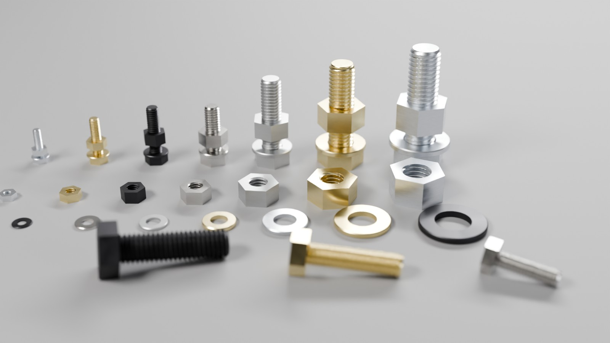
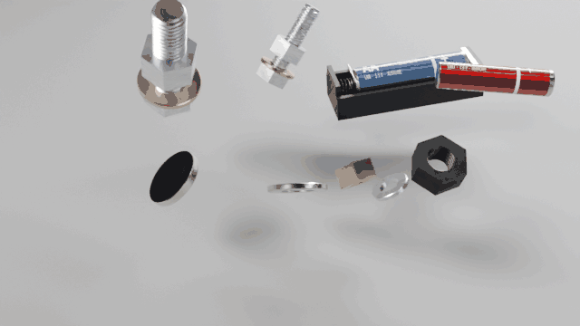
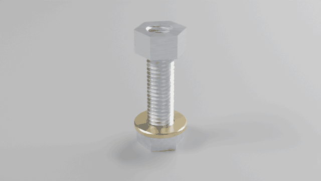
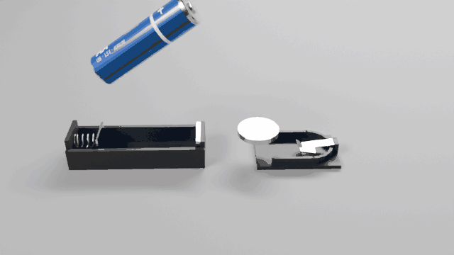
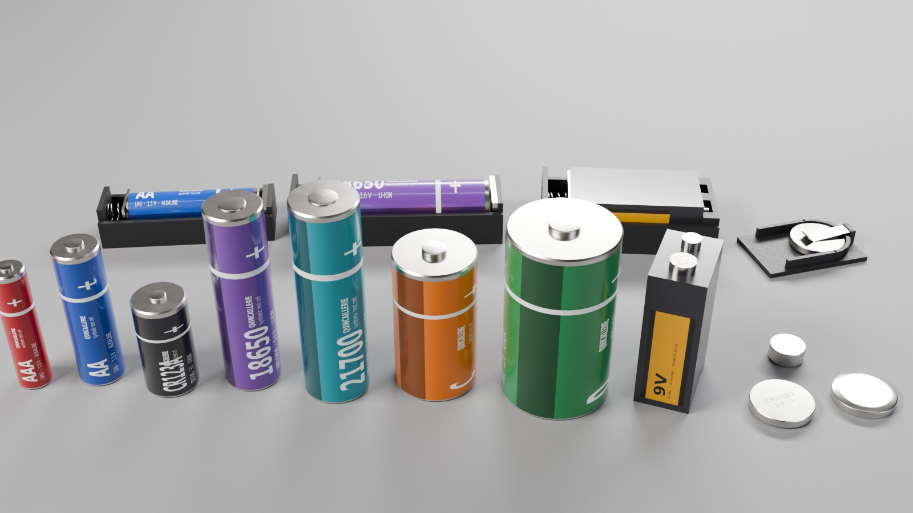

<h1 align="center">
  <picture>
    <source media="(prefers-color-scheme: dark)" srcset="docs/images/logo-dark.svg">
    
  </picture>
</h1>

<p align="center"><strong>Standard hardware assets generator for Physical AI.</strong></p>

<p align="center">
  <a href="https://github.com/drscaon/quincaillerie/actions/workflows/ci.yml"></a>
  
  
</p>

Quincaillerie (French for *hardware*, the nuts and bolts kind) generates
metric **screws, nuts and washers with modelled threads**, and **battery
cells with the holders they go in**, and exports them to **OpenUSD** as
physics-ready assets: rigid bodies with real masses and inertias, convex
collision pieces that follow the thread's helix, and holders whose spring or
clip is a `UsdPhysics` joint with a drive. A nut screws onto its screw, one
pitch per turn; a cell pushed into its holder compresses the spring with the
force it was designed for, and a 9 V battery put in backwards does not fit.

The assets are checked in **MuJoCo** and in **Blender**: dropped on a floor,
assembled, screwed, inserted, without coming apart. A Blender add-on sets the
rigid bodies and constraints up by itself when a file is imported, so that
pressing Play just works.

It is built for **Physical AI**: robots that assemble, sort, screw and swap
batteries are trained and tested in simulation, and they need small parts
with exact geometry and physics, not a cylinder named "bolt". Everything
runs on CPU. Quincaillerie is the fourth project of a series, after
[Granulaire](https://github.com/drscaon/granulaire) (granular assets),
[Maillage](https://github.com/drscaon/maillage) (textiles) and
[Filaire](https://github.com/drscaon/filaire) (cables), and follows the same
approach: distributions instead of one shape, measured outputs, honest limits.



*ISO 4017 screws, ISO 7089 washers and ISO 4032 nuts, M3 to M12, in the six
finishes of the material library. The nuts sit on the thread at the height
their rotation gives them; the loose parts in front were dropped in MuJoCo
and rest where they fell. Imported from the OpenUSD files into Blender and
rendered with Cycles.*

## The physics, in motion

| Dropped in Blender | Screwed in MuJoCo | Inserted in MuJoCo |
|---|---|---|
|  |  |  |
| Two screw + washer + nut assemblies, an AA cell in its holder and loose parts, imported with File > Import > USD (add-on enabled) and dropped: Blender's rigid bodies, nothing set by hand. The nuts stay on their threads, the cell stays in its holder. | A nut driven by a torque on an M10 screw: it advances 1.5 mm per turn on the modelled thread, the washer waits below. | An AA cell and a CR2032 carried into their holders and released: the spring plate slides back and the coil compresses, the clip lifts and holds the coin cell. |

All three are rendered in Blender (Cycles) from the generated OpenUSD files:
[`scripts/physics_gifs.py`](scripts/physics_gifs.py).

## What it does

- **Fasteners**, metric coarse thread, M3 to M12: hex head screws (ISO 4017,
  fully threaded, any length), hex nuts (ISO 4032), plain washers (ISO 7089).
  The visual mesh carries the ISO 68-1 thread profile; the collision is a
  core cylinder plus one convex piece per 10° of helix (≈ 800 per screw, 200
  per nut) with 0.05 mm of radial clearance, so a nut really screws on.
  Six finishes as a variant set: clear and yellow zinc, black oxide,
  stainless A2, plain steel, brass.
- **Cells and holders**: AAA, AA, C, D, CR123A, 18650, 21700 in cradles with
  a coil spring; the 9 V block in a holder whose terminal slots are keyed;
  CR2032 and LR44 under a hinged leaf-spring clip. The spring stiffness and
  wire come from the contact force and preload (k = G d⁴ / 8 D³ n); the clip
  torsion from the force at its lever arm.
- **Related elements** on request (`--with`): a screw with its nut and
  washer, a cell with its holder, and a scene with the assemblies and *N*
  copies of each part resting on a floor.
- **OpenUSD**: one file per part, one rigid body per moving part with *one*
  visual mesh (so every DCC imports one object per body), mass, centre of
  mass and principal inertia, convex collision shapes, physics materials,
  joints with drives, mate frames (thread axis, drive, terminals, cell seat),
  PhysX attributes for Isaac Sim. A shared material library in
  UsdPreviewSurface and MaterialX.
- **Checks** (`quincaillerie sim-test`, `quincaillerie blender-test`): the
  same scenes, read back from the files, in MuJoCo and in Blender.
- **A Blender add-on** (`quincaillerie blender-addon`): rigid bodies and
  constraints set up on every USD import.
- `--no-physics` for visual-only assets.

## Installation

```bash
python -m venv .venv && source .venv/bin/activate
pip install -e ".[sim]"            # add ",dev" for tests and linting, ",materialx" for the .mtlx file
```

Requires Python 3.10+. Dependencies: NumPy, SciPy, Pillow and the OpenUSD
bindings (`usd-core`); MuJoCo for the checks. The Blender checks need Blender
as a Python module (`pip install bpy`, Python 3.13) or a Blender executable.

## Usage

```bash
quincaillerie list                                          # sizes, formats, finishes
quincaillerie generate screw M8 --length 30 --with nut,washer --count 10
quincaillerie generate cell 18650 --with holder
quincaillerie generate holder 9V --with cell --no-physics   # visuals only
quincaillerie generate all                                  # the whole catalogue (41 assets)
quincaillerie sim-test output/ISO4017_M8x30 --screwing      # MuJoCo checks
quincaillerie blender-test output/catalog                   # the same in Blender
quincaillerie blender-addon                                 # quincaillerie_physics.zip
```

`python -m quincaillerie ...` works too. From Python:

```python
from quincaillerie import generate, resolve

parts = resolve("screw", "M6", length=25, with_=["nut", "washer"])
generate(parts, "output", count=10)  # -> output/ISO4017_M6x25/
```

### Options of `quincaillerie generate`

| Option | Default | Effect |
|---|---|---|
| `KIND KEY` | | `screw`, `nut`, `washer` and a size (`M3`…`M12`); `cell`, `holder` and a format (`AA`, `18650`, `9V`, `CR2032`…); or `all` |
| `--length L` | per size (M8: 30) | screw length in mm, from 2 pitches to 200 mm |
| `--with KINDS` | | related elements: `nut,washer` (screw), `screw,washer` (nut), `holder` (cell), `cell` (holder) |
| `--count N` | 1 | copies of each part in the scene, at rest on the floor |
| `--finish F` | `zinc_clear` | default finish of the fasteners (all six are in every file's variant set) |
| `--no-physics` | | no rigid bodies, colliders, joints or physics scene |
| `--no-scene` | | assets and materials only |
| `--seed S`, `--out DIR` | 1, `output` | |

### Catalogue

| Part | Sizes or formats | Mass (g) | Collision |
|---|---|---|---|
| Hex head screw, ISO 4017 | M3 to M12, any length | M3×12: 0.91 · M8×30: 15.4 · M12×40: 45.2 | core + head + ≈ 800 thread pieces |
| Hex nut, ISO 4032 | M3 to M12 | M3: 0.38 · M8: 5.55 · M12: 15.7 | ≈ 200 pieces (ridge + ring sectors) |
| Plain washer, ISO 7089 | M3 to M12 | M3: 0.12 · M8: 1.81 · M12: 6.19 | 24 ring sectors |
| Cylindrical cell + cradle | AAA, AA, C, D, CR123A, 18650, 21700 | 11.5 to 135 (typical) | can + button cylinders; holder: boxes, spring plate on a prismatic joint |
| 9 V block + keyed holder | 9V (6LR61) | 45 | box + two snap cylinders; terminal slots sized to the snaps |
| Coin / button cell + clip | CR2032, LR44 | 2.9, 1.9 | can + cap cylinders; clip on a revolute joint |

Fastener dimensions (across flats, head height, nut height, washer
diameters, pitch) are the nominal values found in public tables; the ISO
standards themselves were not consulted, and the files say `dimensionsStatus
= nominal`. Cell dimensions are the nominal IEC sizes; masses and contact
forces are typical orders of magnitude. The labels on the cells are generic
("QUINCAILLERIE synthetic test cell"), no brand.



*Every cell format, and AA, 18650, 9 V and CR2032 cells seated in their
holders (spring compressed, clip lifted), rendered in Blender.*

## Outputs (under `output/<set>/`)

| File | Content |
|---|---|
| `assets/*.usdc`, `assets/*.usda` | one asset per part (Blender: File > Import > USD) |
| `materials/` | `quincaillerie_materials.usda` (UsdPreviewSurface + MaterialX), `.mtlx`, textures |
| `scene.usda` | every part `--count` times on a floor collider, plus the assemblies |
| `parts.csv`, `summary.json` | names, kinds, masses, collision pieces |
| `sim_test/` | test scenes and reports (`sim-test`, `blender-test`) |

### OpenUSD layout

Z up, metres, kilograms; each asset's root prim is its default prim.

```
/ISO4017_M8x30                 Xform, RigidBodyAPI, MassAPI, quincaillerie:* attributes, variant set "finish"
  /Visual/ISO4017_M8x30_mesh   one mesh, GeomSubset per material
  /Collision/core, head, thread_0000 …   Cylinder / convexHull meshes, purpose guide
  /MateFrame_thread, /MateFrame_drive    +Z = screwing axis; hex drive across flats
  /Looks, /PhysicsMaterials

/Holder_AA
  /base                        RigidBodyAPI (ABS mass), Visual/Holder_AA_base_mesh, Visual/spring_coil, Collision/…
  /spring_plate                RigidBodyAPI, Visual, Collision/minus_plate
  /Joints/spring               PrismaticJoint base -> spring_plate, linear drive = the coil spring (N/m)
```

The underside of a holder is at z = 0 of the asset: it sits on a floor where
it is placed. Angular drives use UsdPhysics units (per degree). Every
collider has `PhysxCollisionAPI` offsets and every body `PhysxRigidBodyAPI`
iterations, read by Isaac Sim and ignored elsewhere.

## Blender

Blender's USD importer reads geometry and materials but ignores UsdPhysics:
imported as is, a holder is three loose objects and a nut a convex lump that
cannot go on a screw. The add-on fixes that once and for all:

1. `quincaillerie blender-addon` writes `quincaillerie_physics.zip`.
2. In Blender (4.4 or later): Edit > Preferences > Get Extensions > Install
   from Disk, pick the zip.
3. File > Import > Universal Scene Description, as usual: every body gets its
   rigid body, every joint its constraint. Press Play.

On import it moves each body's origin to its centre of mass (Blender uses the
origin as centre of mass), makes its collision shape a compound of the USD
shapes (rebuilt from the file, cylinders with 96 sides instead of the
importer's 20), sets mass, friction and small collision margins, turns
joints into Generic Spring constraints with the USD limits, stiffness and
damping, keeps holder coils attached to their spring plate, and sets the
rigid body world to 2000 substeps per second. The same file runs as a script
(`blender -b -P quincaillerie_physics.py -- file.usda`) without installing.

Bullet takes a spring's rest position from the first frame, so a cell placed
already seated in its holder is held by the holder's shape but without the
spring's push: it stays seated, it is not pressed.

## Checks

`quincaillerie sim-test` (MuJoCo, CPU) and `quincaillerie blender-test`
(Blender rigid bodies) build the same small OpenUSD scenes, with the assets
referenced and a floor at z = 0, saved under `sim_test/scenes/`:

| Check | Scene | Pass when |
|---|---|---|
| drop | each part, tilted, dropped from 4–5 cm | rests on the floor: lowest point within 0.35 mm of it, vertical speed below 1 mm/s (round cells may keep rolling) |
| nut_on_screw | a nut on its screw, both dropped | the nut stays on its thread: shift below half a pitch, off-axis below 0.3 mm |
| holder | an empty holder on the floor | the base settles (0.15 mm) and the plate or clip stays put relative to it (0.05 mm) |
| seated | a cell in its holder, on the floor | relative to the holder, the cell moves less than 0.6 mm (its side play), the contact less than 0.3 mm |
| insertion (MuJoCo) | a cell carried into its holder and released, then the same reversed | seated, spring at its design compression, contact force within 10 %; reversed: wrong polarity, or refused by the keying (9 V) |
| screwing (MuJoCo, `--screwing`) | a nut driven 1 turn/s on a fixed screw, then back | advance per turn within 5 % of the pitch |

### Results

`quincaillerie generate all` then the checks of the whole catalogue (41
assets), MuJoCo 3.17 and Blender 5.2 (`bpy`), one CPU core:

| Check | MuJoCo | Blender (add-on) | Blender, rigid bodies added by hand |
|---|---|---|---|
| drop (31 parts) | 31/31 | 31/31 | 31/31 |
| nut on screw (M3–M12) | 7/7, the nut settles 0.10–0.13 mm (its flank clearance) | 7/7 | 0/7: the nut's convex hull fills the hole and is ejected |
| empty holder (10) | 10/10 | 10/10 | 0/10: base and plate fall apart |
| cell seated in its holder (10) | 10/10 | 10/10 | 0/10 |
| insertion (10 formats, both ways) | 20/20 | | |
| screwing (M3–M12) | 7/7: 0.501, 0.70, 0.80, 0.99–1.005, 1.25, 1.50, 1.75 mm per turn | | |

Insertion: every cradle spring compressed to its design within 0.03 mm, with
its design force within 1 % (AA: 4.98/5.0 mm, 3.48 N for 3.5 N); the 9 V
seats when it is the right way round and is stopped by the terminal slots
when reversed; the coin clips press with 2.81 N (CR2032, 3.0 N designed)
and 1.82 N (LR44, 2.0 N). The checks of the whole catalogue take about four
minutes in MuJoCo and two in Blender; screwing, 1–2 minutes per size.

## Limits

- **Nominal, not measured.** Fastener dimensions come from public tables,
  not from the standards; cell masses and spring forces are typical. Screws
  are fully threaded (no plain shank) and have no chamfer under the head.
- **Collision in pieces.** A thread is ≈ 1000 convex pieces: exact enough to
  screw, heavy for large scenes (a scene of 100 screws is 100 000 shapes).
  Loose parts that only need to fall could use a simplified collider; not
  generated yet.
- **Simplified holders.** Generic designs (ABS boxes, a flat spring plate),
  not a product; no electrical contact model.
- **Blender springs start at rest.** See [Blender](#blender): a cell placed
  already seated is not pressed by the spring.
- **Isaac Sim not tested here.** The files follow the standard `UsdPhysics`
  schemas and carry PhysX attributes, but have not been loaded in Isaac Sim
  (no NVIDIA GPU); drive units and contact offsets may need adjusting there.

## Roadmap

1. Tools that go with the parts: screwdriver bits and screwdrivers, hex keys
   and wrenches matched to the drives (`--with tool`), and tapped bases.
2. More fasteners: socket head cap screws (ISO 4762), countersunk and pan
   head screws, partially threaded shanks, lock and spring washers.
3. Simplified colliders for parts that only need to fall; level of detail.
4. A PhysX test in Isaac Sim; CAD export (STEP) of the same parametric parts.
5. Assembly tasks: torque, misalignment tolerances, success labels.

## Development

The project follows **GitHub Flow**:

1. `main` is always releasable and protected: changes reach it only through
   pull requests, nobody pushes to it directly.
2. Every change starts on a short-lived branch from `main`, named after its
   type: `feat/<name>`, `fix/<name>`, `docs/<name>`, `ci/<name>`, …
3. Push the branch and open a pull request into `main`; CI runs on it.
4. Merge when CI is green, then delete the branch.

Releasing is a change like any other: on a `chore/release-X.Y.Z` branch, bump
`version` in `pyproject.toml` and move the `Unreleased` entries of
`CHANGELOG.md` under the new version; merge the pull request, then tag
`vX.Y.Z` on `main`. The release workflow builds the packages and attaches
them, with the Blender add-on, to the GitHub release.

A versioned `pre-push` hook refuses direct pushes to `main`. Enable it once per
clone with `git config core.hooksPath .githooks` (emergency override:
`ALLOW_MAIN_PUSH=1 git push`).

The README images are made by [`scripts/`](scripts/): `make_logo.py` (logo),
`readme_images.py` (Blender renders and the GitHub social preview
`docs/images/social_preview.png`, to upload in the repository's Settings >
General > Social preview), `physics_gifs.py` (the animations).

### Continuous integration

| Workflow | When | What |
|---|---|---|
| `ci.yml` | every push to `main`, every pull request | `ruff check` and `ruff format --check`; `pytest` on Python 3.10–3.13 (Linux) and 3.12 (macOS, Windows); a command-line smoke test; **the MuJoCo checks of the whole catalogue** and an M8 screwing; **the Blender checks of the whole catalogue** through the add-on (and, for comparison, by hand); reports kept as run artifacts; build the wheel and sdist, `twine check`, install the wheel in a clean environment. |
| `release.yml` | a pushed tag `v*` | checks the tag matches the version in `pyproject.toml`, tests, builds, then creates the GitHub release with the packages and the Blender add-on attached and the notes taken from `CHANGELOG.md`. Versions with `a`, `b` or `rc` are marked as pre-releases. |
| Dependabot | monthly | pull requests to update the GitHub Actions and the Python dependencies. |

## License

[MIT](LICENSE) © 2026 Daniel Régis Sarmento Caon

The logo is drawn from DejaVu Sans Bold outlines (Bitstream Vera license),
converted to paths, so it displays without the font installed.
