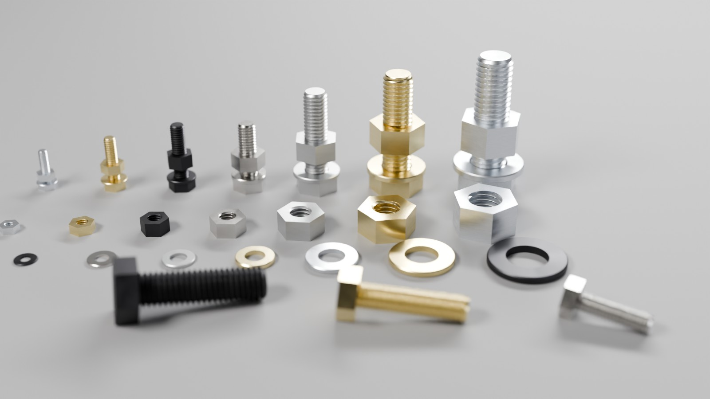
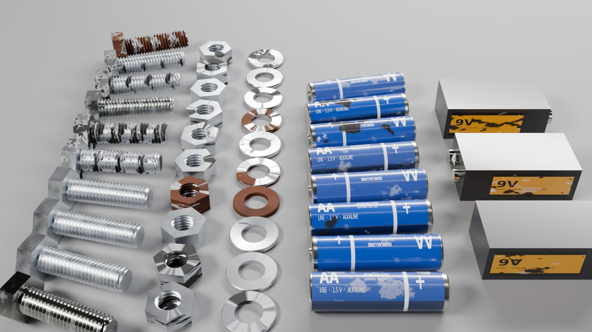
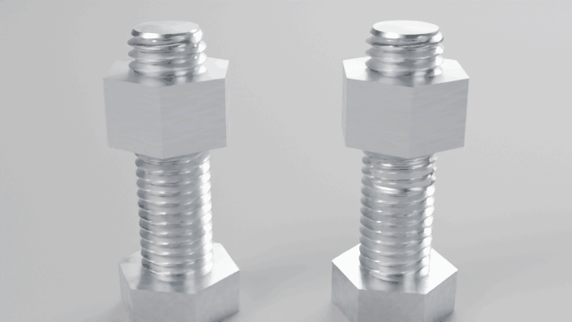
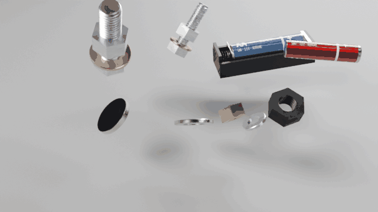
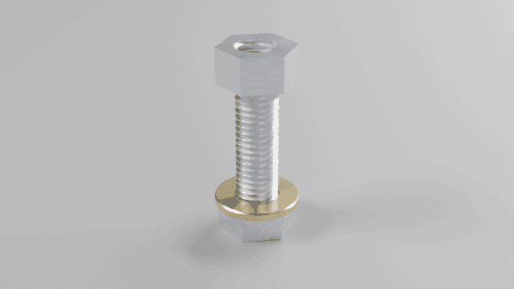
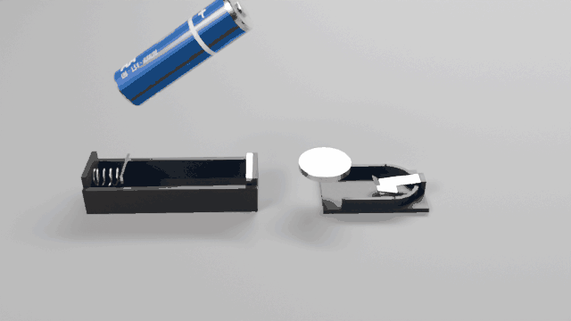
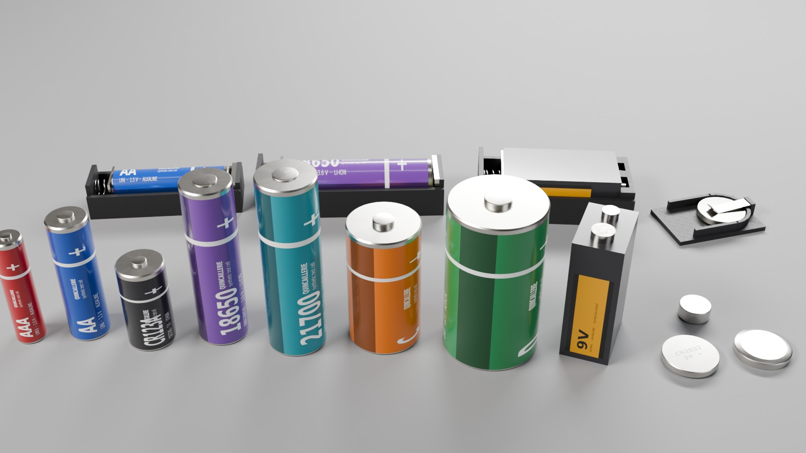

<h1 align="center">
  <picture>
    <source media="(prefers-color-scheme: dark)" srcset="https://raw.githubusercontent.com/drscaon/quincaillerie/main/docs/images/logo-dark.svg">
    
  </picture>
</h1>

<p align="center"><strong>Standard hardware assets generator for Physical AI.</strong></p>

<p align="center">
  <a href="https://github.com/drscaon/quincaillerie/actions/workflows/ci.yml"></a>
  <a href="https://pypi.org/project/quincaillerie/"></a>
  
  
  <a href="https://primvaria.com"></a>
</p>

Quincaillerie (French for *hardware*, the nuts and bolts kind) generates
metric **screws, nuts and washers with modelled threads**, and **battery
cells with the holders they go in**, and exports them to **OpenUSD** as
physics-ready assets: rigid bodies with real masses and inertias, convex
collision pieces that follow the thread's helix, and holders whose spring or
clip is a `UsdPhysics` joint with a drive. A nut screws onto its screw, one
pitch per turn; a cell pushed into its holder compresses the spring with the
force it was designed for, and a 9 V battery put in backwards does not fit.

**No two parts are the same.** A real box of M8 screws is not one screw a
hundred times: some threads fit tighter than others, a few are damaged, some
are rusty or oily, springs get tired. Quincaillerie draws every instance from
those distributions: tolerances, defects, wear and physics, each with its
own random stream, and writes what it drew into the file and into a CSV, as
ground truth. The variation is not paint: a crushed thread really stops a
nut, a tired spring really presses less, a rusty screw really has more
friction.

The assets are checked in **MuJoCo** and in **Blender**: dropped on a floor,
assembled, screwed, inserted, without coming apart. A Blender add-on sets the
rigid bodies and constraints up by itself when a file is imported, so that
pressing Play just works.

It is built for **Physical AI**: robots that assemble, sort, screw and swap
batteries are trained and tested in simulation, and they need small parts with
exact geometry and physics, not a cylinder named "bolt". Everything can run on
CPU. Quincaillerie is part of [**Primvaria**](https://primvaria.com), with
[Granulaire](https://github.com/drscaon/granulaire) (granular assets),
[Maillage](https://github.com/drscaon/maillage) (textiles) and
[Filaire](https://github.com/drscaon/filaire) (cables), and follows the same
approach: distributions instead of one shape, measured outputs, honest limits.



*ISO 4017 screws, ISO 7089 washers and ISO 4032 nuts, M3 to M12, in the six
finishes of the material library. The nuts sit on the thread at the height
their rotation gives them; the loose parts in front were dropped in MuJoCo
and rest where they fell. Imported from the OpenUSD files into Blender and
rendered with Cycles.*

## Every instance is different



*`quincaillerie generate screw M10 --with nut,washer --count 10` and the same
for AA and 9 V cells: each part is a distinct file. Rust, grime, oil and
scratches; scuffed and faded labels; a dished washer, oval and crushed nuts,
crushed and bent screws (not all visible from here); and, invisible in a
picture, a different thread fit, alloy density, friction and spring for each.*

| Aspect | Fasteners | Cells | Holders |
|---|---|---|---|
| **tolerance** | thread clearance per side within the fit class: 6g for screws, 6H for nuts (at M8: 0.015–0.075 mm and 0.015–0.080 mm, see [Thread fit](#thread-fit)), across flats, head and nut height, length | diameter and length under nominal, within the IEC bands | side play of the cradle (0–0.6 mm) |
| **defect** (`--defect-rate`, 15 %) | crushed thread (crests pushed sideways over 40–140°: jams a nut), bent shank (0.8–3°), burr at the tip; oval or crushed nut; dished washer | dented can, corroded terminal (crust) | |
| **wear** | new, used, oily, rusty, dirty: rust, oil, grime and scratches baked into the instance's own textures; friction follows (rust ×1.8 at most, oil ×0.6) | scuffed and faded label, grime | grey or black ABS |
| **physics** | density of the alloy (brass and stainless are solid alloys, the rest plated steel), friction | mass ±3 %, friction | spring stiffness ±8 %, tired springs (preload down to 70 %), clip torque ±10 %, friction |

Each aspect has its own random stream: `--no-vary wear` keeps the same
tolerances and defects with clean parts; the same seed gives the same parts.
Everything drawn is in `instances.csv` and in each file as
`primvaria:variation:*` attributes; the clean finishes stay available in
the `finish` variant set of a worn part. `--nominal` gives the reference part.



*The defects are physical. The same nut, the same light torque (a hand on a
nut driver), simulated in MuJoCo from the files: it runs down the sound
screw (left) and stops at the crushed thread of the other (right).
`quincaillerie sim-test --defects` checks this for every crushed screw of a
batch.*

Only crushed threads jam a nut: one screw in three with a defect, so the jam
rate is a third of `--defect-rate` (5 % at the default 15 %). Measured on 40
screws: [Defect rate and jam rate](https://github.com/drscaon/quincaillerie/blob/main/docs/jam-rate.md).

## The physics, in motion

| Dropped in Blender | Screwed in MuJoCo | Inserted in MuJoCo |
|---|---|---|
|  |  |  |
| Two screw + washer + nut assemblies, an AA cell in its holder and loose parts, imported with File > Import > USD (add-on enabled) and dropped: Blender's rigid bodies, nothing set by hand. The nuts stay on their threads, the cell stays in its holder. | A nut driven by a torque on an M10 screw: it advances 1.5 mm per turn on the modelled thread, the washer waits below. | An AA cell and a CR2032 carried into their holders and released: the spring plate slides back and the coil compresses, the clip lifts and holds the coin cell. |

All three are rendered in Blender (Cycles) from the generated OpenUSD files:
[`scripts/physics_gifs.py`](https://github.com/drscaon/quincaillerie/blob/main/scripts/physics_gifs.py).

## What it does

- **Fasteners**, metric coarse thread, M3 to M12: hex head screws (ISO 4017,
  fully threaded, any length), hex nuts (ISO 4032), plain washers (ISO 7089).
  The visual mesh carries the ISO 68-1 thread profile; the collision is a
  core cylinder plus one convex piece per 10° of helix (≈ 800 per screw, 200
  per nut) with 0.05 mm of radial clearance, so a nut really screws on.
  Six finishes as a variant set: clear and yellow zinc, black oxide,
  stainless A2, plain steel, brass.
- **Cells and holders**: AAA, AA, C, D, CR123A, 18650, 21700 in cradles with
  a coil spring; the 9 V block in a holder whose terminal slots are keyed;
  CR2032 and LR44 under a hinged leaf-spring clip. The spring stiffness and
  wire come from the contact force and preload (k = G d⁴ / 8 D³ n); the clip
  torsion from the force at its lever arm.
- **Variation**: `--count N` distinct instances of each part, with drawn
  tolerances, defects, wear and physics (see above), and their ground truth.
- **Related elements** on request (`--with`): a screw with its nut and
  washer, a cell with its holder, and a scene with every instance resting on
  a floor, plus the assemblies (made of instances without defects).
- **OpenUSD**: one file per part, one rigid body per moving part with *one*
  visual mesh (so every DCC imports one object per body), mass, centre of
  mass and principal inertia, convex collision shapes, physics materials,
  joints with drives, mate frames (thread axis, drive, terminals, cell seat),
  PhysX attributes for Isaac Sim. A shared material library in
  UsdPreviewSurface and MaterialX.
- **Checks** (`quincaillerie sim-test`, `quincaillerie blender-test`): the
  same scenes, read back from the files, in MuJoCo and in Blender.
- **A Blender add-on** (`quincaillerie blender-addon`): rigid bodies and
  constraints set up on every USD import.
- `--no-physics` for visual-only assets.

## Engines

Every file is OpenUSD with standard `UsdPhysics` schemas. Where each engine
stands, as on the [Primvaria engine matrix](https://primvaria.com/#engines):

| Engine | Status |
|---|---|
| OpenUSD validators (`usdchecker`) | **tested**: every part of the catalogue and varied instances, in CI |
| Blender | **tested**: drop and assemblies through the add-on (`quincaillerie blender-test`) |
| MuJoCo | **tested**: drop, screwing, jammed threads, insertion (`quincaillerie sim-test`) |
| NVIDIA Isaac Sim (PhysX) | not tested yet (needs an NVIDIA RTX GPU); `UsdPhysics` and PhysX attributes |

## Installation

From PyPI:

```bash
pip install "quincaillerie[sim]"
```

From a clone, for development:

```bash
python -m venv .venv && source .venv/bin/activate
pip install -e ".[sim]"            # add ",dev" for tests and linting, ",materialx" for the .mtlx file
```

Requires Python 3.11+. Dependencies: NumPy, SciPy, Pillow and the OpenUSD
bindings (`usd-core` 26.5+); MuJoCo for the checks. The Blender checks need Blender
as a Python module (`pip install bpy`, Python 3.13) or a Blender executable.

Earlier `usd-core` wheels generate the same files, but their OpenUSD
validators do not load (25.5 ships without the validator
libraries, 25.8 and 25.11 without the UsdPreviewSurface definitions), and CI
tests both 26.5 and the newest release.

## Usage

```bash
quincaillerie list                                          # sizes, formats, finishes
quincaillerie generate screw M8 --length 30 --with nut,washer --count 100
quincaillerie generate cell 18650 --with holder --count 20 --defect-rate 0.3
quincaillerie generate screw M8 --count 50 --no-vary wear   # clean parts, varied fits and defects
quincaillerie generate nut M10 --nominal                    # the reference part
quincaillerie generate holder 9V --with cell --no-physics   # visuals only
quincaillerie generate all --nominal                        # the whole catalogue (41 assets)
quincaillerie sim-test output/ISO4017_M8x30 --defects       # MuJoCo checks (+ crushed threads jam)
quincaillerie blender-test output/catalog                   # the same in Blender
quincaillerie blender-addon                                 # quincaillerie_physics.zip
```

`python -m quincaillerie ...` works too. From Python:

```python
from quincaillerie import generate, resolve

parts = resolve("screw", "M6", length=25, with_=["nut", "washer"])
generate(parts, "output", count=100, defect_rate=0.2)  # -> output/ISO4017_M6x25/
generate(parts, "output", vary=("tolerance", "physics"))  # clean, undamaged, varied fits
```

Four short scripts in [`examples/`](https://github.com/drscaon/quincaillerie/tree/main/examples)
show the rest, each explained by its own comments: a first pack and its
ground truth, one aspect switched off, reading the files with OpenUSD alone,
and a nut screwed on in MuJoCo.

### Options of `quincaillerie generate`

| Option | Default | Effect |
|---|---|---|
| `KIND KEY` | | `screw`, `nut`, `washer` and a size (`M3`…`M12`); `cell`, `holder` and a format (`AA`, `18650`, `9V`, `CR2032`…); or `all` |
| `--length L` | per size (M8: 30) | screw length in mm, from 2 pitches to 200 mm |
| `--with KINDS` | | related elements: `nut,washer` (screw), `screw,washer` (nut), `holder` (cell), `cell` (holder) |
| `--count N` | 1 | distinct instances of each part, each with its own drawn variation, all in the scene |
| `--defect-rate R` | 0.15 | share of instances with a defect |
| `--thread-play` | `class` | thread clearance: `class` (drawn in the 6g / 6H fit), `middle` (the middle of the fit for every instance, whatever the seed) or `legacy` (the range used before the fit classes: 1.6–8 % of the pitch), see [Thread fit](#thread-fit) |
| `--no-vary ASPECTS` | | aspects that stay nominal: `tolerance`, `defect`, `wear`, `physics` |
| `--nominal` | | no variation: the reference part (`--count` copies in the scene) |
| `--detail` | `normal` | visual mesh resolution, `low`, `normal` or `high` (1.4, 3.4 and 7.5 MB for an M8 × 30 screw) |
| `--collider` | `thread` | collision of the fasteners: `thread` (the helix in convex pieces: nuts screw on, crushed threads jam) or `simple` (the envelope alone: 2 pieces for a screw, 12 for a nut, 8 for a washer), see [Simple colliders](#simple-colliders) |
| `--finish F` | `zinc_clear` | default finish of the fasteners (all six are in every file's variant set) |
| `--no-physics` | | no rigid bodies, colliders, joints or physics scene |
| `--no-scene` | | assets and materials only |
| `--seed S`, `--out DIR` | 1, `output` | the same seed and options give the same parts |

### Catalogue

| Part | Sizes or formats | Mass (g) | Collision |
|---|---|---|---|
| Hex head screw, ISO 4017 | M3 to M12, any length | M3×12: 0.91 · M8×30: 15.4 · M12×40: 45.2 | core + head + ≈ 800 thread pieces |
| Hex nut, ISO 4032 | M3 to M12 | M3: 0.38 · M8: 5.55 · M12: 15.7 | ≈ 200 pieces (ridge + ring sectors) |
| Plain washer, ISO 7089 | M3 to M12 | M3: 0.12 · M8: 1.81 · M12: 6.19 | 24 ring sectors |
| Cylindrical cell + cradle | AAA, AA, C, D, CR123A, 18650, 21700 | 11.5 to 135 (typical) | can + button cylinders; holder: boxes, spring plate on a prismatic joint |
| 9 V block + keyed holder | 9V (6LR61) | 45 | box + two snap cylinders; terminal slots sized to the snaps |
| Coin / button cell + clip | CR2032, LR44 | 2.9, 1.9 | can + cap cylinders; clip on a revolute joint |

Fastener dimensions (across flats, head height, nut height, washer
diameters, pitch) are the nominal values found in public tables; the ISO
standards themselves were not consulted, and the files say `dimensionsStatus
= nominal`. Cell dimensions are the nominal IEC sizes; masses and contact
forces are typical orders of magnitude. The labels on the cells are generic
("QUINCAILLERIE synthetic test cell"), no brand.



*Every cell format, and AA, 18650, 9 V and CR2032 cells seated in their
holders (spring compressed, clip lifted), rendered in Blender.*

## Outputs (under `output/<set>/`)

| File | Content |
|---|---|
| `assets/*.usdc`, `assets/*.usda` | one file per instance, `ISO4017_M8x30_007.usdc` (Blender: File > Import > USD) |
| `materials/` | `quincaillerie_materials.usda` (UsdPreviewSurface + MaterialX), `.mtlx`, textures; `instances/`: the baked textures of worn instances |
| `scene.usda` | every instance on the shared ground (see below), plus the assemblies |
| `instances.csv` | one row per instance, read back from the files: its identity, **every drawn value** (`variation:<name>`) and **every measured value** (`measured:<name>`), then its kind, size or format: the ground truth |
| `manifest.json` | what the pack is (contract, generator, version, preset, seed, aspects, files) and its summary: counts by kind and by defect, the options used |
| `sim_test/` | test scenes and reports (`sim-test`, `blender-test`) |

### OpenUSD layout

Z up, metres, kilograms; each asset's root prim is its default prim.

```
/ISO4017_M8x30                 Xform, RigidBodyAPI, MassAPI, quincaillerie:* attributes, variant set "finish"
  /Visual/ISO4017_M8x30_mesh   one mesh, GeomSubset per material
  /Collision/core, head, thread_0000 …   Cylinder / convexHull meshes, purpose guide
  /MateFrame_thread, /MateFrame_drive    +Z = screwing axis; hex drive across flats
  /Looks, /PhysicsMaterials

/Holder_AA
  /base                        RigidBodyAPI (ABS mass), Visual/Holder_AA_base_mesh, Visual/spring_coil, Collision/…
  /spring_plate                RigidBodyAPI, Visual, Collision/minus_plate
  /Joints/spring               PrismaticJoint base -> spring_plate, linear drive = the coil spring (N/m)
```

The underside of a holder is at z = 0 of the asset: it sits on a floor where
it is placed. Angular drives use UsdPhysics units (per degree). Every
collider has `PhysxCollisionAPI` offsets and every body `PhysxRigidBodyAPI`
iterations, read by Isaac Sim and ignored elsewhere.


### Ground and physics scene (the same in every Primvaria project)

Every file with physics carries the same two prims, so that assets from
different generators can share one scene and every engine gets the same floor:

| Prim | What it is |
|---|---|
| `/World/PhysicsScene` | gravity 9.81 m/s² along −Z |
| `/World/Ground` | a static box (`UsdGeom.Cube`, `CollisionAPI`), its top face at z = 0, 2 cm thick, covering the content with 0.5 m to spare on each side (1 m × 1 m at least), grey and rendered, no PhysX attributes (engines derive their contact offsets) |
| `/World/GroundMaterial` | its physics material: static friction 0.6, dynamic friction 0.5, restitution 0.1, a wooden or concrete floor |

The code is one file, `ground.py`, identical in Granulaire, Maillage, Filaire
and Quincaillerie; a test checks every generated file against it. The MuJoCo
checks and the Blender rigid-body checks take the ground's friction from the
file (Blender's cloth, in Maillage, has its own collision settings).

## Blender

Blender's USD importer reads geometry and materials but ignores UsdPhysics:
imported as is, a holder is three loose objects and a nut a convex lump that
cannot go on a screw. The add-on fixes that once and for all:

1. `quincaillerie blender-addon` writes `quincaillerie_physics.zip`.
2. In Blender (4.4 or later): Edit > Preferences > Get Extensions > Install
   from Disk, pick the zip.
3. File > Import > Universal Scene Description, as usual: every body gets its
   rigid body, every joint its constraint. Press Play.

On import it moves each body's origin to its centre of mass (Blender uses the
origin as centre of mass), makes its collision shape a compound of the USD
shapes (rebuilt from the file, cylinders with 96 sides instead of the
importer's 20), sets mass, friction and small collision margins, turns
joints into Generic Spring constraints with the USD limits, stiffness and
damping, keeps holder coils attached to their spring plate, and sets the
rigid body world to 2000 substeps per second. The same file runs as a script
(`blender -b -P quincaillerie_physics.py -- file.usda`) without installing.

Bullet takes a spring's rest position from the first frame, so a cell placed
already seated in its holder is held by the holder's shape but without the
spring's push: it stays seated, it is not pressed.

## Checks

`quincaillerie sim-test` (MuJoCo, CPU) and `quincaillerie blender-test`
(Blender rigid bodies) build the same small OpenUSD scenes, with the assets
referenced and a floor at z = 0, saved under `sim_test/scenes/`:

| Check | Scene | Pass when |
|---|---|---|
| drop | each part, tilted, dropped from 4–5 cm | rests on the floor: lowest point within 0.35 mm of it, vertical speed below 1 mm/s (round cells may keep rolling) |
| nut_on_screw | a nut on its screw, both dropped | the nut stays on its thread: shift below half a pitch, off-axis below 0.3 mm |
| holder | an empty holder on the floor | the base settles (0.3 mm) and the plate or clip stays put in the base's frame (0.05 mm) |
| seated | a cell in its holder, on the floor | relative to the holder, the cell stays within the holder's side play (+0.6 mm), the contact moves less than 0.3 mm |
| insertion (MuJoCo) | a cell carried into its holder and released, then the same reversed | seated, spring at the compression *this* holder should get from *this* cell (its drawn preload and the cell's drawn length), force within 10 % (coin clips: 15 %, the contact point is estimated); reversed: wrong polarity, or refused by the keying (9 V) |
| screwing (MuJoCo, `--screwing`) | a nut driven 1 turn/s on a fixed screw, then back | advance per turn within 5 % of the pitch |
| jam (MuJoCo, `--defects`) | a sound nut driven with a light torque towards the crushed thread of a screw, and the same on a sound screw | it stops at the damage: it travels at least a quarter pitch less than on the sound screw |

With varied instances, nut-on-screw pairs and assemblies are made of
instances without defects; the defective ones are dropped like the others,
and the crushed threads are checked by the jam test.

### Results

`quincaillerie generate all --nominal` then the checks of the whole
catalogue (41 assets), one CPU core; measured with MuJoCo 3.17, before 4.0 (CI
runs every check on MuJoCo 4), and Blender 5.2 (`bpy`):

| Check | MuJoCo | Blender (add-on) | Blender, rigid bodies added by hand |
|---|---|---|---|
| drop (31 parts) | 31/31 | 31/31 | 31/31 |
| nut on screw (M3–M12) | 7/7, the nut settles 0.10–0.13 mm (its flank clearance) | 7/7 | 0/7: the nut's convex hull fills the hole and is ejected |
| empty holder (10) | 10/10 | 10/10 | 0/10: base and plate fall apart |
| cell seated in its holder (10) | 10/10 | 10/10 | 0/10 |
| insertion (10 formats, both ways) | 20/20 | | |
| screwing (M3–M12) | 7/7: 0.501, 0.70, 0.80, 0.99–1.005, 1.25, 1.50, 1.75 mm per turn | | |

A varied batch, `quincaillerie generate all --count 5 --defect-rate 0.2
--seed 11` (205 instances, 33 of them with a defect: 9 crushed threads, 11
dished washers, 2 bent screws, 2 burrs, 1 oval nut, 2 dented cans, 6 corroded
terminals), then `sim-test --defects` and `blender-test`:

| Check | MuJoCo | Blender (add-on) |
|---|---|---|
| drop (155 parts) | 155/155 | 155/155 |
| nut on screw (2 pairs per size) | 14/14 | 14/14 |
| empty holder (50) | 50/50 | 50/50 |
| cell seated in its holder (50) | 50/50 | 50/50 |
| insertion (50 pairs, both ways) | 100/100, each against its own drawn spring and cell | |
| jam (crushed screws) | 3/3: the nut stops after 0.5–1.2 mm, where it runs 1.5–2.4 mm on a sound screw | |

Insertion: every cradle spring compressed to its design within 0.03 mm, with
its design force within 1 % (AA: 4.98/5.0 mm, 3.48 N for 3.5 N); the 9 V
seats when it is the right way round and is stopped by the terminal slots
when reversed; the coin clips press with 2.81 N (CR2032, 3.0 N designed)
and 1.82 N (LR44, 2.0 N). The checks of the whole catalogue take about four
minutes in MuJoCo and two in Blender; screwing, 1–2 minutes per size.

## OpenUSD compliance

```bash
python -m quincaillerie.validate output/catalog
```

This runs every validator of OpenUSD's `UsdValidation` registry on each file,
the checks `usdchecker` runs: composition, stage metadata (meters, Z up),
geometry, material bindings, shaders, UsdPhysics rigid bodies and colliders,
joints and articulations. Each file is checked once per variant (every
finish), since a variant that is not selected is not composed. The tests and
CI require no error and no warning, on every part of the catalogue and on
varied, worn and defective instances.

MaterialX networks (`ND_*` shaders) are checked by these validators only with
an OpenUSD build that has its MaterialX plugin; the `usd-core` wheels from
PyPI have none, so this check is skipped there. The `.mtlx` document is
validated against the MaterialX standard library when the `materialx` extra is
installed.

## Simple colliders

A threaded fastener collides as its helix, in convex pieces: 837 for an
M8 × 30 screw. That is what lets a nut screw on and a crushed thread
jam, and it is heavy for scenes with many parts. When parts only need to
fall, pile up and be grasped, generate them with their envelope alone:

```bash
quincaillerie generate screw M8 --with nut,washer --count 100 --collider simple
quincaillerie sim-test output/ISO4017_M8x30 --scene      # the whole scene settles (MuJoCo)
```

| Part | `thread` | `simple` |
|---|---|---|
| Screw | the helix, a core and the head (837 pieces at M8 × 30) | a cylinder at the major diameter and the head |
| Nut | the internal helix (198 pieces at M8) | twelve wedges around a smooth bore, never narrower than the screw |
| Washer | 24 ring sectors | 8 ring sectors |

The visual mesh, the mass, the inertia, the materials and every drawn value
are the same in both: only the collision changes, and each file says which
it has (`quincaillerie:collision`, and `measured:colliders` in
`instances.csv`). A scene of 100 screws, 100 nuts and 100 washers (303
bodies) settles on the floor in MuJoCo 4.0 in about 25 s on one CPU; the
scene lays the instances out 25 to a row on a floor that covers them all.
`sim-test` skips the tests that need a thread (a nut held on a screw,
screwing, jamming) for parts with simple colliders.

## Primvaria contract

```bash
python -m quincaillerie.conformance output/catalog
```

Quincaillerie is part of [Primvaria](https://primvaria.com) and follows its
[mission](https://github.com/drscaon/primvaria/blob/main/MISSION.md) and its
[OpenUSD contract](https://github.com/drscaon/primvaria/blob/main/docs/contract.md),
version 0, which the four generators share. Every part is an asset any tool can find without knowing Quincaillerie: a model of kind
`component` with `assetInfo` (name, identifier, version) and the attributes
`primvaria:contract`, `primvaria:generator`, `primvaria:version`,
`primvaria:preset` and `primvaria:seed`; in `scene.usda`, `/World` is an `assembly` that references them; `primvaria:preset` is the catalogue entry the instance was drawn from (`ISO4017_M8x30`). The command above checks
the stage units, the model hierarchy and this identity; the tests and CI
require it on every preset.

What was drawn for each instance is in the file too, its ground truth:
`primvaria:variation:aspects` lists the aspects that were switched on
(`tolerance`, `defect`, `wear`, `physics`) and `primvaria:variation:<name>` holds each drawn value
(the `variation:*` columns of `instances.csv`, under the same names: `clearance_mm`, `defect`, `rust`, `spring_factor`…). An aspect that is switched off is still recorded, at its
nominal value, and the other aspects keep their draws.

What was measured on each instance once generated is there as well, as
`primvaria:measured:<name>` (`mass_kg`, `colliders`).
The pack's `instances.csv` is read back from the OpenUSD files, one row per
asset with the same names (`variation:<name>`, `measured:<name>`), and
`manifest.json` says what the pack is; both have the same shape in the four
generators, and the command above fails when the table and the files disagree.

## Thread fit

The play of each thread is drawn inside the usual commercial fit, a 6g screw
in a 6H nut, and recorded as `clearance_mm` and `thread_class`. The limits
are computed from the public formulas of the ISO metric thread tolerance
system ([`fits.py`](https://github.com/drscaon/quincaillerie/blob/main/src/quincaillerie/fits.py)),
not copied from the standard's tables; they land within 5 % of the values
printed in handbooks, which a test checks for M3 to M12.

| Size | Screw 6g, clearance per side (mm) | Nut 6H, clearance per side (mm) |
|---|---|---|
| M3 | 0.015–0.049 | 0.015–0.052 |
| M4 | 0.015–0.056 | 0.015–0.059 |
| M5 | 0.015–0.059 | 0.015–0.062 |
| M6 | 0.015–0.068 | 0.015–0.073 |
| M8 | 0.015–0.075 | 0.015–0.080 |
| M10 | 0.016–0.081 | 0.015–0.086 |
| M12 | 0.017–0.091 | 0.015–0.098 |

`--thread-play` chooses how: `class` (default) draws across the band;
`middle` gives every instance the middle of its band, so the play no longer
depends on the seed; `legacy` draws in the range used before the fit classes
(1.6–8 % of the pitch) and gives, for a seed, exactly the clearances of 0.2.0b1
and earlier. The choice moves the clearance only: every other
drawn value of an instance stays the same.

Two simplifications. The draw is uniform across the band, where a real
production run clusters around its middle. And no part is tighter than
0.015 mm per side, so that the collision pieces can slide: a real 6H nut may
have no play of its own, and the tightest 6g screw has 0.010 to 0.017 mm.
Across flats, heights and lengths are still drawn in plausible ranges, not
from a tolerance class.

## Limits

- **Nominal, not measured.** Fastener dimensions come from public tables,
  not from the standards; cell masses and spring forces are typical. Screws
  are fully threaded (no plain shank) and have no chamfer under the head.
- **Plausible variation, not measured distributions.** The ranges (fits,
  defect sizes, wear, spring scatter) are realistic orders of magnitude, not
  statistics of a production line. Dents and corrosion crusts are visual
  only; crushed threads, bends, burrs, oval nuts and dished washers change
  the collision too.
- **Collision in pieces.** A thread is ≈ 1000 convex pieces: exact enough to
  screw, heavy for large scenes (a scene of 100 screws is 100 000 shapes).
  Engines that size their contact buffers in advance feel it first: loaded in
  [Newton](https://github.com/newton-physics/newton) (CPU), a scene of 3 M8
  screws, nuts and washers (4 224 shapes) filled its default buffer of
  210 600 contacts and the washers fell through the floor; with 400 000
  they rest, the buffer still full. Raise the engine's contact limits for
  threaded parts, keep them few per scene, or generate the parts that only
  need to fall, pile up and be grasped with `--collider simple`.
- **Simple colliders do not screw or jam.** With `--collider simple` a nut
  slides freely over a shank and a crushed thread no longer stops it: the
  defect is still drawn, recorded and visible, but it is not physical. Bent
  shanks, oval nuts and dished washers keep their effect.
- **Simplified holders.** Generic designs (ABS boxes, a flat spring plate),
  not a product; no electrical contact model.
- **Blender springs start at rest.** See [Blender](#blender): a cell placed
  already seated is not pressed by the spring.
- **Isaac Sim not tested here.** The files follow the standard `UsdPhysics`
  schemas and carry PhysX attributes, but have not been loaded in Isaac Sim
  (no NVIDIA GPU); drive units and contact offsets may need adjusting there.

## Roadmap

1. Tools that go with the parts: screwdriver bits and screwdrivers, hex keys
   and wrenches matched to the drives (`--with tool`), and tapped bases.
2. More fasteners: socket head cap screws (ISO 4762), countersunk and pan
   head screws, partially threaded shanks, lock and spring washers.
3. A PhysX test in Isaac Sim; CAD export (STEP) of the same parametric parts.
4. Assembly tasks: torque, misalignment tolerances, success labels.

## Development

The project follows **GitHub Flow**:

1. `main` is always releasable and protected: changes reach it only through
   pull requests, nobody pushes to it directly.
2. Every change starts on a short-lived branch from `main`, named after its
   type: `feat/<name>`, `fix/<name>`, `docs/<name>`, `ci/<name>`, …
3. Push the branch and open a pull request into `main`; CI runs on it.
4. Merge when CI is green, then delete the branch.

Releasing is a change like any other: on a `chore/release-X.Y.Z` branch, bump
`version` in `pyproject.toml` and move the `Unreleased` entries of
`CHANGELOG.md` under the new version; merge the pull request, then tag
`vX.Y.Z` on `main`. The release workflow builds the packages and attaches
them, with the Blender add-on, to the GitHub release.

A versioned `pre-push` hook refuses direct pushes to `main`. Enable it once per
clone with `git config core.hooksPath .githooks` (emergency override:
`ALLOW_MAIN_PUSH=1 git push`).

The README images are made by [`scripts/`](https://github.com/drscaon/quincaillerie/blob/main/scripts/): `make_logo.py` (logo),
`readme_images.py` (Blender renders and the GitHub social preview
`docs/images/social_preview.png`, to upload in the repository's Settings >
General > Social preview), `physics_gifs.py` (the animations).

### Continuous integration

| Workflow | When | What |
|---|---|---|
| `ci.yml` | every push to `main`, every pull request | `ruff check` and `ruff format --check`; `pytest` on Python 3.11–3.13 (Linux) and 3.12 (macOS, Windows); a command-line smoke test; **the MuJoCo checks of the whole catalogue** and an M8 screwing, then **varied batches** (screws and nuts with crushed threads that must jam, cells and holders with drawn tolerances and springs); **the Blender checks** of the catalogue and of varied batches through the add-on (and, for comparison, by hand); reports kept as run artifacts; build the wheel and sdist, `twine check`, install the wheel in a clean environment. |
| `release.yml` | a pushed tag `v*` | checks the tag matches the version in `pyproject.toml`, tests, builds, then creates the GitHub release with the packages and the Blender add-on attached and the notes taken from `CHANGELOG.md`. Versions with `a`, `b` or `rc` are marked as pre-releases. |
| Dependabot | monthly | pull requests to update the GitHub Actions and the Python dependencies. |

## License

[MIT](https://github.com/drscaon/quincaillerie/blob/main/LICENSE) © 2026 Daniel Régis Sarmento Caon

The logo is drawn from DejaVu Sans Bold outlines (Bitstream Vera license),
converted to paths, so it displays without the font installed.

---

Quincaillerie is part of [**Primvaria**](https://primvaria.com), physics-ready variability for Physical AI, in OpenUSD: `pip install primvaria` installs the whole suite ([source](https://github.com/drscaon/primvaria)).
