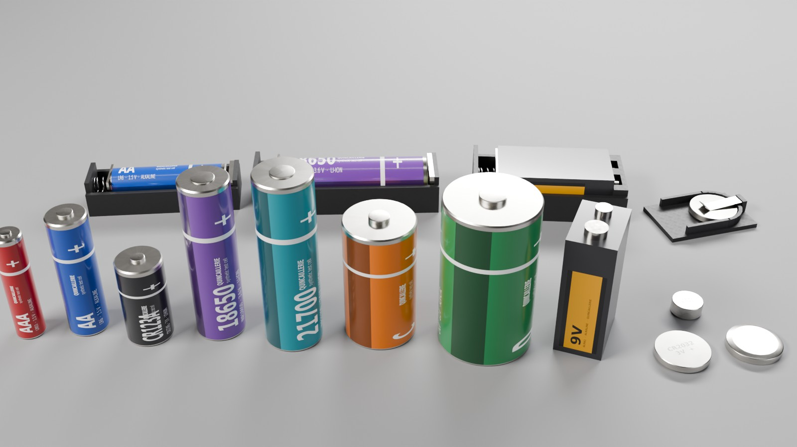

# Usage in depth

Every option of `quincaillerie generate` and the catalogue of sizes and cell formats.

Part of the [Quincaillerie](../README.md) documentation.

## Options of `quincaillerie generate`

| Option | Default | Effect |
|---|---|---|
| `KIND KEY` | | `screw`, `nut`, `washer` and a size (`M3`…`M12`); `cell`, `holder` and a format (`AA`, `18650`, `9V`, `CR2032`…); or `all` |
| `--length L` | per size (M8: 30) | screw length in mm, from 2 pitches to 200 mm |
| `--with KINDS` | | related elements: `nut,washer` (screw), `screw,washer` (nut), `holder` (cell), `cell` (holder) |
| `--count N` | 1 | distinct instances of each part, each with its own drawn variation, all in the scene |
| `--defect-rate R` | 0.15 | share of instances with a defect |
| `--thread-play` | `class` | thread clearance: `class` (drawn in the 6g / 6H fit), `middle` (the middle of the fit for every instance, whatever the seed) or `legacy` (the range used before the fit classes: 1.6–8 % of the pitch), see [Thread fit](physics.md#thread-fit) |
| `--no-vary ASPECTS` | | aspects that stay nominal: `tolerance`, `defect`, `wear`, `physics` |
| `--nominal` | | no variation: the reference part (`--count` copies in the scene) |
| `--detail` | `normal` | visual mesh resolution, `low`, `normal` or `high` (1.4, 3.4 and 7.5 MB for an M8 × 30 screw) |
| `--collider` | `thread` | collision of the fasteners: `thread` (the helix in convex pieces: nuts screw on, crushed threads jam) or `simple` (the envelope alone: 2 pieces for a screw, 12 for a nut, 8 for a washer), see [Simple colliders](physics.md#simple-colliders) |
| `--finish F` | `zinc_clear` | default finish of the fasteners (all six are in every file's variant set) |
| `--no-physics` | | no rigid bodies, colliders, joints or physics scene |
| `--no-scene` | | assets and materials only |
| `--seed S`, `--out DIR` | 1, `output` | the same seed and options give the same parts |

## Catalogue

| Part | Sizes or formats | Mass (g) | Collision |
|---|---|---|---|
| Hex head screw, ISO 4017 | M3 to M12, any length | M3×12: 0.91 · M8×30: 15.4 · M12×40: 45.2 | core + head + ≈ 800 thread pieces |
| Hex nut, ISO 4032 | M3 to M12 | M3: 0.38 · M8: 5.55 · M12: 15.7 | ≈ 200 pieces (ridge + ring sectors) |
| Plain washer, ISO 7089 | M3 to M12 | M3: 0.12 · M8: 1.81 · M12: 6.19 | 24 ring sectors |
| Cylindrical cell + cradle | AAA, AA, C, D, CR123A, 18650, 21700 | 11.5 to 135 (typical) | can + button cylinders; holder: boxes, spring plate on a prismatic joint |
| 9 V block + keyed holder | 9V (6LR61) | 45 | box + two snap cylinders; terminal slots sized to the snaps |
| Coin / button cell + clip | CR2032, LR44 | 2.9, 1.9 | can + cap cylinders; clip on a revolute joint |

Fastener dimensions (across flats, head height, nut height, washer
diameters, pitch) are the nominal values found in public tables; the ISO
standards themselves were not consulted, and the files say `dimensionsStatus
= nominal`. Cell dimensions are the nominal IEC sizes; masses and contact
forces are typical orders of magnitude. The labels on the cells are generic
("QUINCAILLERIE synthetic test cell"), no brand.

*Every cell format, and AA, 18650, 9 V and CR2032 cells seated in their
holders (spring compressed, clip lifted), rendered in Blender.*
